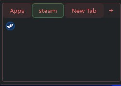

# App Coupling+

A configurable application-launcher widget for KDE Plasma 6 with independent launcher groups, optional tabs, drag-and-drop ordering, and flexible layouts.

 
 


## Features

- **Appearance:** Normal, Transparent, or Reveal on hover, with optional theme-colored outlines.
- **Launchers:** Drag to reorder, duplicate, and customize individual names and icons.
- **Tabs:** Independent launcher lists, flexible positioning, Shift+scroll navigation, and optional per-tab name labels.
- **Layout:** Adjustable rows, columns, icon sizes, spacing, and Automatic/Fixed/Fill sizing.
- **Overflow:** Paged arrows, `+N` popup, or scrolling.

## Installation

**KDE Plasma 6 is required.**

Get the matching package from [GitHub Releases](https://github.com/suppdiff/app_coupling_plus/releases).

### Arch Linux

```
cd ~/Downloads
sudo pacman -U ./plasma6-applets-app-coupling-plus-1.2.0-1-x86_64.pkg.tar.zst
```

### Fedora

```
cd ~/Downloads
sudo dnf install ./app-coupling-plus-1.2.0-1.*.x86_64.rpm
```

Use an RPM built and verified for your Fedora version.

### Debian / Ubuntu

```
cd ~/Downloads
sudo apt install ./app-coupling-plus_1.2.0-1_amd64.deb
```

Use a DEB built and verified for your specific Debian/Ubuntu release.

After installing or upgrading, restart the Plasma shell to load the native plugin:

```
systemctl --user restart plasma-plasmashell.service
```

Then select **App Coupling+** in Plasma's **Add Widgets** interface.

## Getting started

Drag applications or `.desktop` files onto App Coupling+ to add launchers. Right-click a launcher to **Edit** its name or icon, move/copy it, or remove it. Drag launchers to reorder them.

Use **Configure App Coupling+** to customize appearance, layout, tabs, and overflow behavior. Enable **Show names** to display labels below icons, and use **Show/hide app names** to control visibility per tab.

Each tab has its own launchers. Use **Shift + scroll** over the tab bar to switch tabs. Changes are saved automatically and persist across Plasma restarts.

## Updating and uninstalling

To update a system installation, install the newer distro package with your package manager, then restart Plasma as above. Existing widget configurations are preserved under the unchanged widget ID `io.github.suppdiff.appcouplingplus`.

To uninstall a system package, use your distro's package manager (`pacman -R plasma6-applets-app-coupling-plus`, `dnf remove app-coupling-plus`, or `apt remove app-coupling-plus`). Uninstalling the package does not intentionally delete your saved Plasma widget configuration.

A user-local source install under `~/.local` may override a system package. If you previously used `./install-local.sh`, run `./uninstall-local.sh` from the source tree to remove that local install before testing the system package. Restart Plasma afterward.

## Building from source

The native helper must be compiled against compatible Qt 6/KDE Frameworks 6 libraries. Building requires:

- A C++20 compiler and CMake 3.20+
- Extra CMake Modules 6+
- Qt 6.7+ development components (`Core`, `Gui`, `Qml`, `Widgets`)
- KDE Frameworks 6 development components (`Config`, `CoreAddons`, `KIO`, `Service`, `IconThemes`, including `IconWidgets`)
- Plasma 6 development files

On Arch/CachyOS, install basic build tools with:

```
sudo pacman -S --needed base-devel cmake extra-cmake-modules
```

Additional Qt/KDE development packages may be needed; CMake will report missing components. In a source checkout, `./install-local.sh` builds and installs under `~/.local` without requiring `sudo`. To make a native package on a supported build host, use:

```
./packaging/build-package.sh arch ./dist     # Arch/CachyOS
# ./packaging/build-package.sh fedora ./dist # on Fedora
# ./packaging/build-package.sh debian ./dist # on Debian/Ubuntu
```

Only ship binary packages after validating them on the intended distro and architecture.

## Security and privacy

- App Coupling+ has no background telemetry or analytics.
- It does not read browser cookies or credentials.
- Launching uses KDE/Qt APIs, not arbitrary shell-command execution exposed to QML.
- Local source installation manages only its files under `~/.local` and its QML-import environment entry.

## Official source and third-party builds

This repository, owned by **suppdiff**, is the canonical upstream source. Forks and repackaged builds are permitted by the license but are unofficial unless linked or endorsed by this repository.

## License

App Coupling+ is licensed under **GPL-3.0-or-later**; see [`LICENSE`](LICENSE) for the full text. Copyright © 2026 suppdiff. Third-party Qt/KDE components have their own licenses.

## Contributing

Issues and pull requests are welcome. Contributions submitted for inclusion must be compatible with `GPL-3.0-or-later`.
